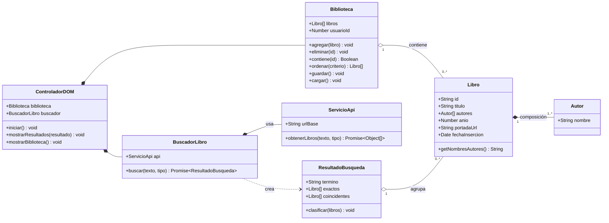
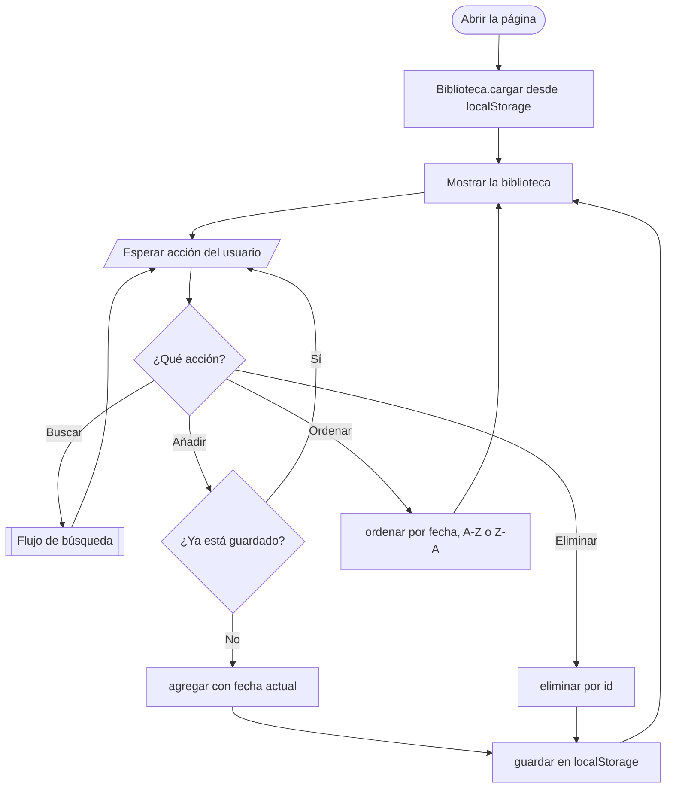
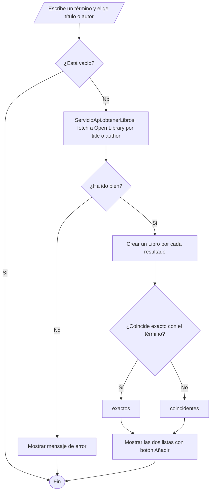
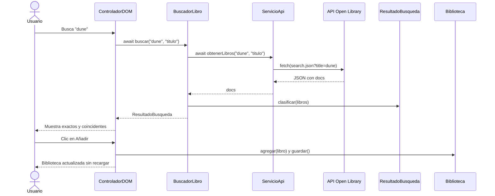

# Biblioteca personal de libros: diagramas

API: Open Library (`https://openlibrary.org/search.json?title=...` y `?author=...`). Portadas: `https://covers.openlibrary.org/b/id/{cover_i}-M.jpg`.

## Diagrama de clases

## Flujo de la aplicación

## Flujo de búsqueda

## Flujo de datos (secuencia)

